<p align="center">
  
</p>

<h1 align="center">Talkiro</h1>

<p align="center">
  <b>Aprende idiomas a tu ritmo, desde casa.</b><br>
  Diez idiomas, del inglés y el francés al japonés, el chino o el árabe, con teoría clara, ejercicios que se corrigen solos y lecturas que te enseñan a desmontar frases largas.
</p>

<p align="center">
  <a href="https://robertmartib.github.io/Talkiro"><b>Web y descargas</b></a> ·
  <a href="https://robertmartib.github.io/Talkiro/app/"><b>Usarla en el navegador</b></a> ·
  <a href="https://github.com/RobertMartiB/Talkiro/releases/latest"><b>Última versión</b></a>
</p>

<p align="center">
  Android · Linux · Windows · Web instalable (también en iPhone) · Gratis, sin cuentas y sin anuncios
</p>

<p align="center">
  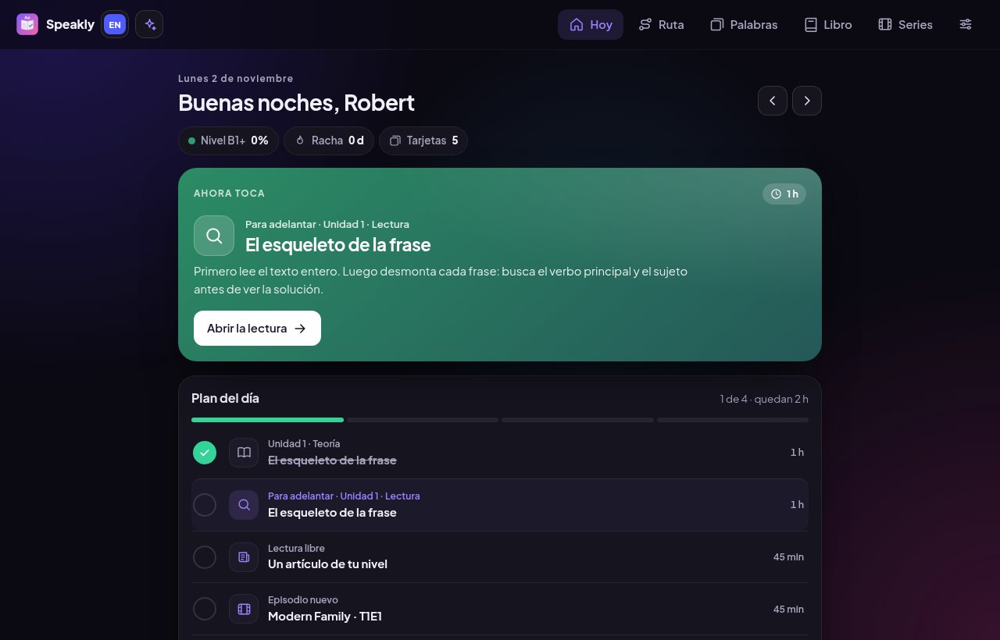
</p>

---

## Índice

- [Qué es](#qué-es)
- [Dos formas de estudiar](#dos-formas-de-estudiar)
- [Un recorrido por la app](#un-recorrido-por-la-app)
- [Cursos disponibles](#cursos-disponibles)
- [En el móvil](#en-el-móvil)
- [Instalar](#instalar)
- [Preguntas frecuentes](#preguntas-frecuentes)
- [Para desarrolladores](#para-desarrolladores)

## Qué es

Talkiro es una app de estudio que te dice **qué hacer cada día** para avanzar en un idioma. En lugar de una lista infinita de lecciones, tienes una **ruta por niveles**. Cada unidad tiene tres partes:

| Parte | Qué haces |
|---|---|
| **Teoría** | Una explicación clara de cuándo se usa cada estructura, con ejemplos y los errores típicos de los hispanohablantes. |
| **Práctica** | Ejercicios que se corrigen al momento: elegir opción, rellenar huecos, ordenar palabras y encontrar el verbo. Cada fallo trae una pista según la palabra que hayas tocado. |
| **Lectura desmontada** | Un texto de tu nivel. Tocas una frase, buscas tú el verbo principal y luego la ves separada en colores: sujeto, verbo, complementos, secundarias y conectores. |

Además tienes **tarjetas de vocabulario** con repetición espaciada, un **libro de gramática** con toda la teoría, **series y películas** desde tu servidor Jellyfin con retos en mitad del episodio y un **mini chat con Claude** para resolver dudas sin salir de la app.

## Dos formas de estudiar

Al empezar un curso, Talkiro te pregunta cómo quieres estudiar. Se puede cambiar en cualquier momento en **Ajustes → Tu forma de estudiar**, y cada curso tiene su propio ritmo.

<p align="center">
  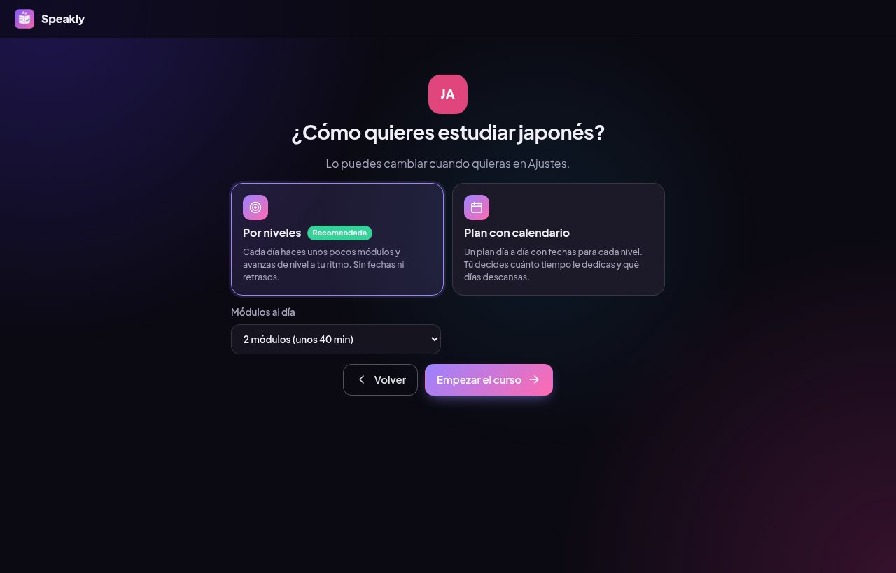
</p>

### Por niveles (recomendada)

Cada día tienes **el mismo día completo que en el calendario** (un módulo de la unidad, una lectura, un episodio de la serie o película y tus tarjetas), ajustado al tiempo que elijas: 30 minutos, 1, 2 o 3 horas. La diferencia es que **no hay fechas**: si un día no estudias, al día siguiente sigues donde lo dejaste, sin días atrasados. Si te sobra tiempo, puedes hacer un módulo más.

- La pantalla **Hoy** muestra tu día: el módulo que toca, la lectura, el episodio y el repaso de tarjetas.
- La **Ruta** se convierte en un recorrido: cada unidad tiene sus tres módulos unidos por una línea. Los hechos salen en verde, el actual destacado con el progreso de la unidad y los siguientes con candado.
- Al tocar un módulo ves qué vas a hacer, cuánto se tarda y un botón para empezar.
- El episodio de la serie avanza a la vez que tú avanzas por el nivel.
- Al final de cada nivel hay un **test de nivel** que haces con Claude.

<table>
  <tr>
    <td width="62%">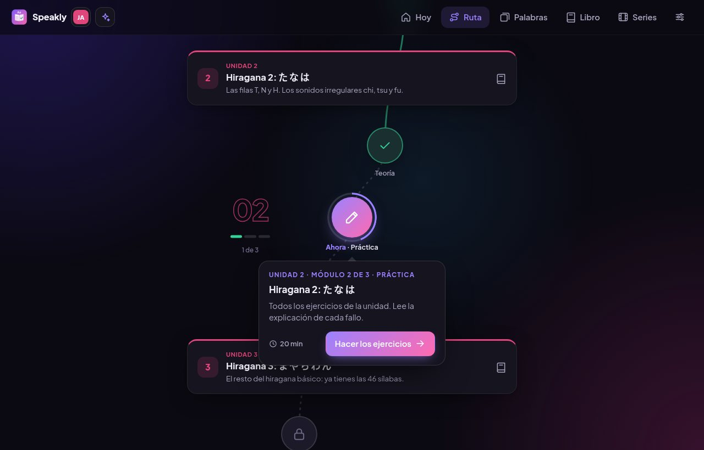</td>
    <td>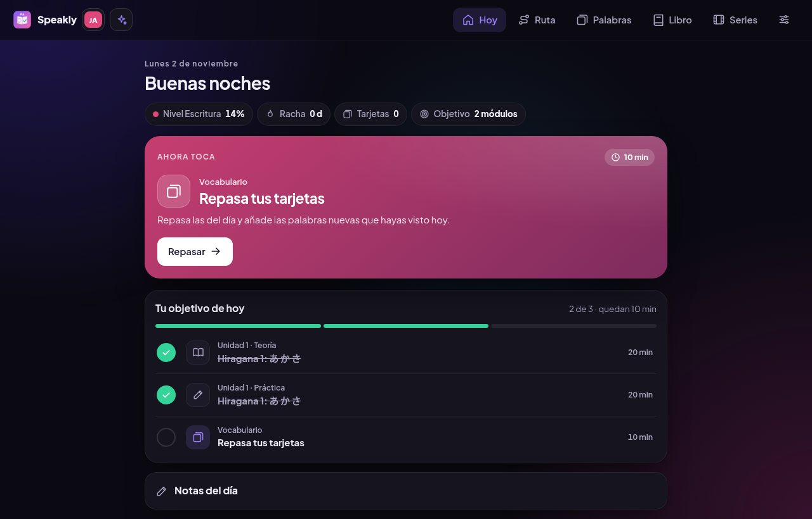</td>
  </tr>
</table>

### Plan con calendario

El mismo día completo, pero con **fechas** para cada nivel. Tú eliges:

- **Tiempo al día**: 30 minutos, 1, 2 o 3 horas. Los bloques se reparten en proporción; con 30 minutos se quedan la unidad, la serie y las tarjetas.
- **Días a la semana**: 5 (descanso el fin de semana), 6 (descanso el domingo) o 7.

El calendario se recalcula solo y te enseña qué días llevas hechos, a medias o atrasados.

<p align="center">
  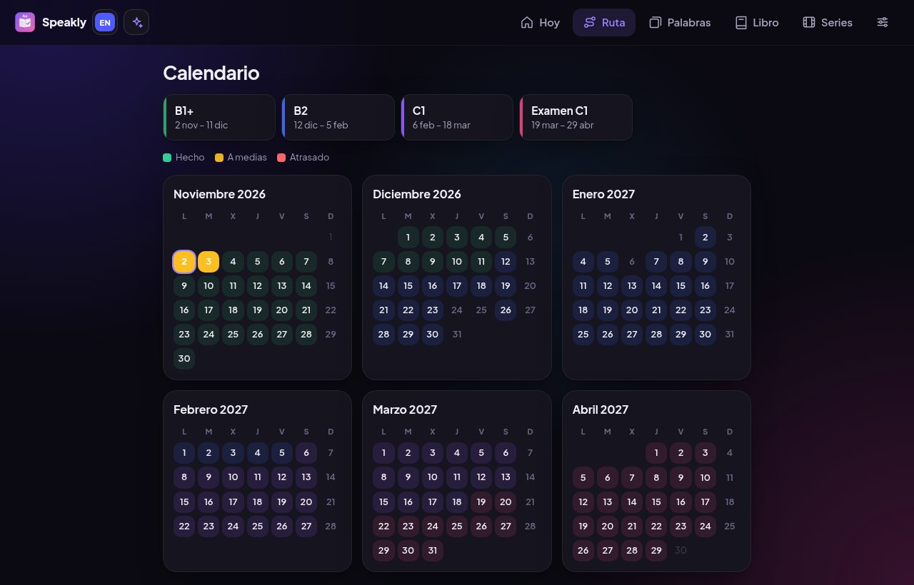
</p>

## Un recorrido por la app

### Elige curso

Al abrir la app eliges el curso. Cada uno guarda su propio progreso, y puedes añadir otro cuando quieras.

<p align="center">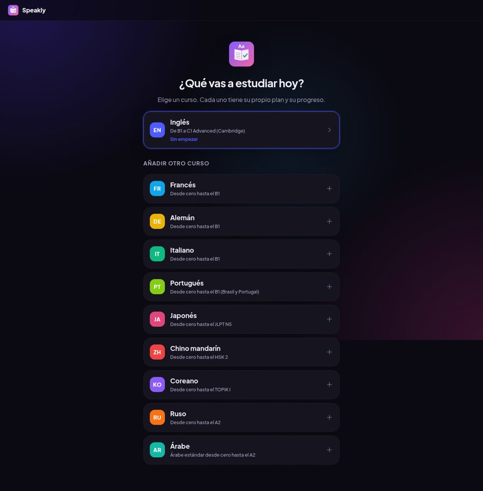</p>

### Teoría y práctica

La teoría se lee con calma y con ejemplos en colores. En la práctica, cada ejercicio se corrige al momento y siempre explica el porqué, aciertes o falles. El botón **Teoría** abre la explicación en un lateral sin perder el ejercicio.

<table>
  <tr>
    <td>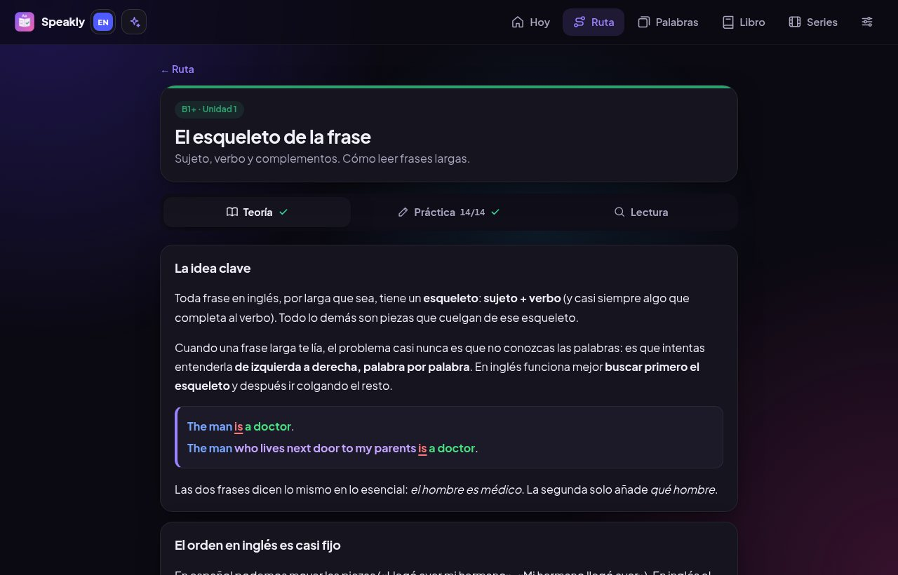</td>
    <td>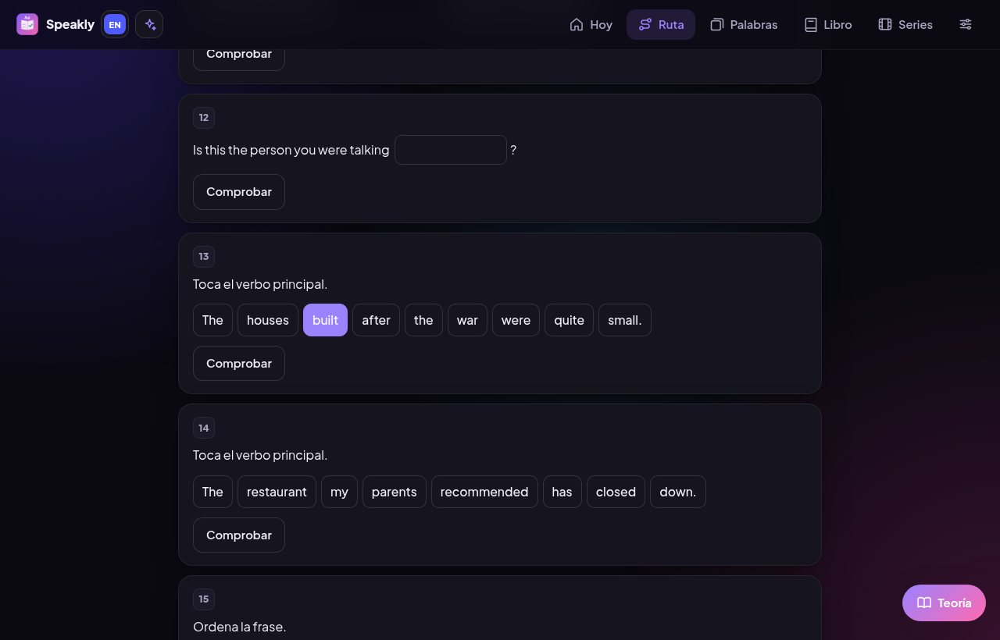</td>
  </tr>
</table>

### Lectura desmontada

La lectura se desbloquea al terminar la práctica. Primero lees el texto entero y después desmontas cada frase: buscas tú el verbo principal y luego ves la frase separada en colores, con traducción, vocabulario para guardar y preguntas de comprensión.

<p align="center">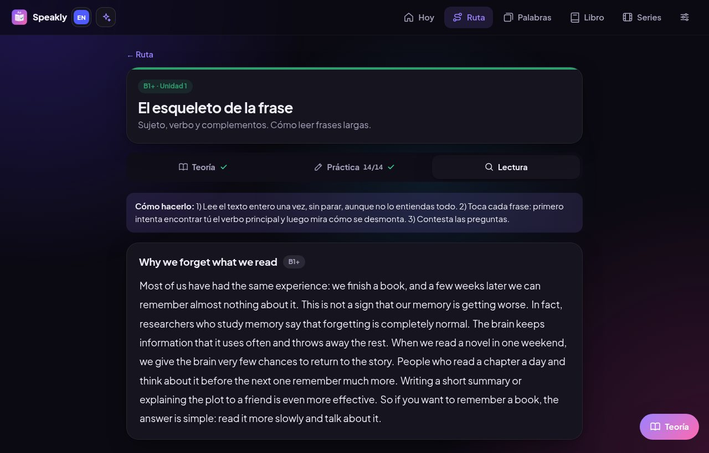</p>

### Libro de gramática y ruta

Toda la teoría de la ruta, ordenada para consultarla, con buscador, tabla de verbos irregulares y una [versión en PDF](https://robertmartib.github.io/Talkiro/libro/Talkiro-Libro-B1.pdf) para imprimir.

<table>
  <tr>
    <td>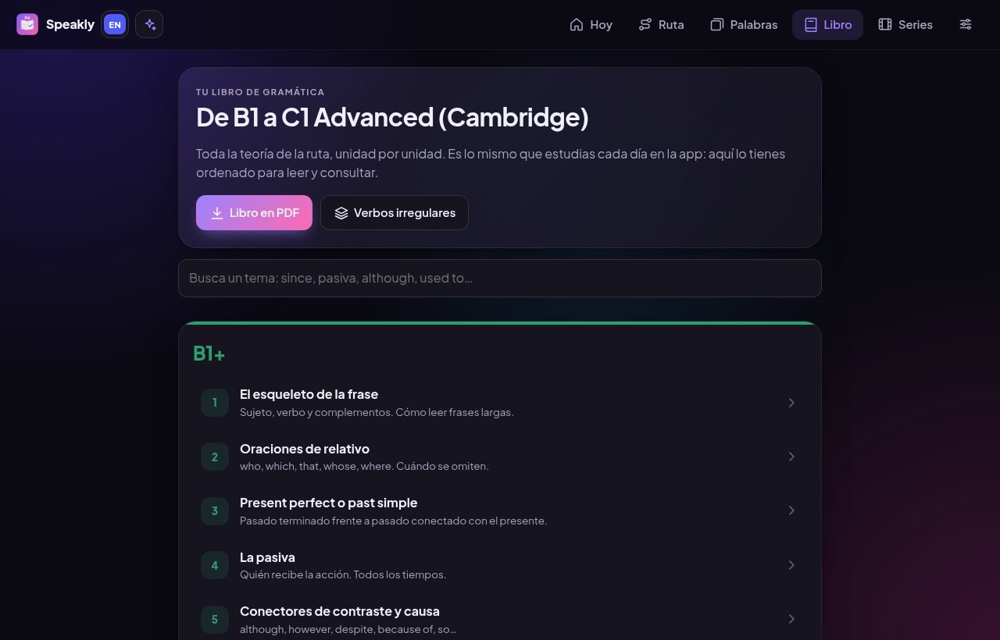</td>
    <td>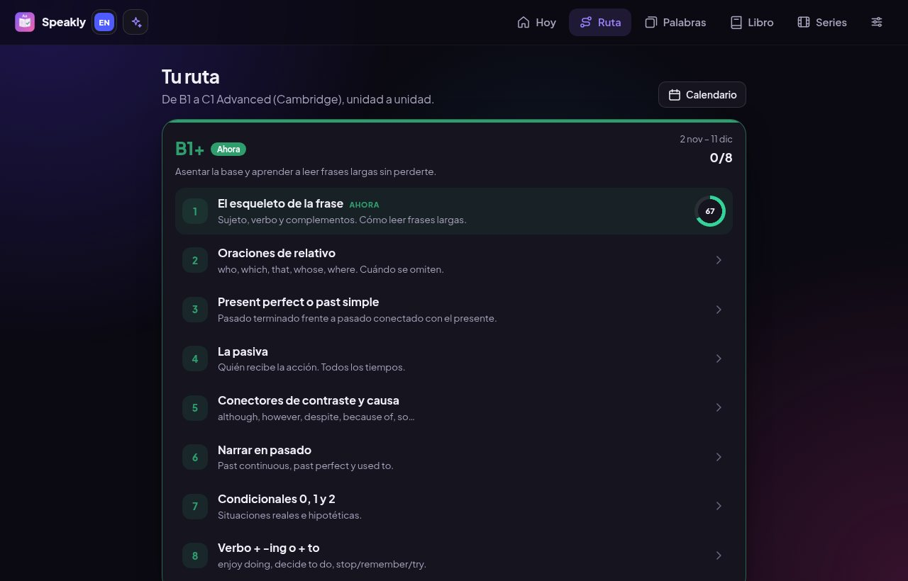</td>
  </tr>
</table>

### Chat con Claude y Ajustes

El botón de arriba a la izquierda abre un chat pequeño para preguntar dudas y pedir traducciones. Usa tu propia clave de API de Anthropic, que se guarda solo en tu dispositivo. En Ajustes eliges el tema (oscuro o claro), tu forma de estudiar, la sincronización y las copias de seguridad.

<table>
  <tr>
    <td>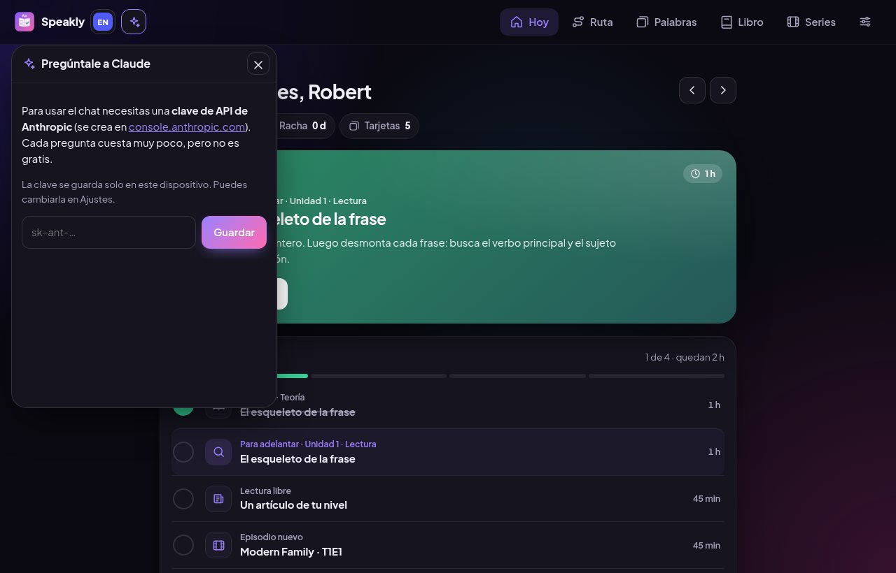</td>
    <td>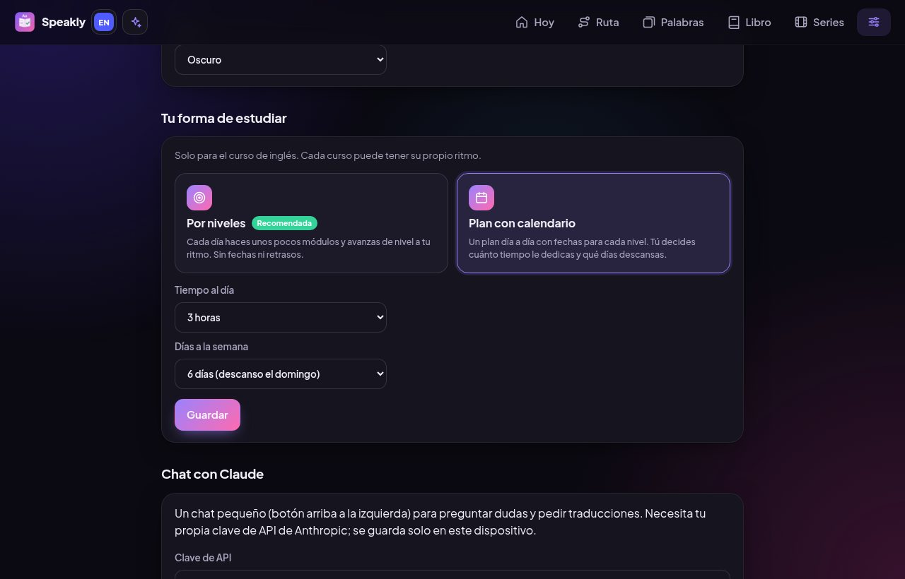</td>
  </tr>
</table>

## Cursos disponibles

| Curso | Niveles | Unidades escritas |
|---|---|---|
| **Inglés** · de B1 a C1 Advanced (Cambridge) | B1+ · B2 · C1 · Examen (formato y simulacros) | 10 de 26 |
| **Francés** · desde cero hasta el B1 | A1 · A2 · B1 | 3 de 24 |
| **Alemán** · desde cero hasta el B1 | A1 · A2 · B1 | 3 de 24 |
| **Italiano** · desde cero hasta el B1 | A1 · A2 · B1 | 3 de 24 |
| **Portugués** · desde cero hasta el B1 (Brasil y Portugal) | A1 · A2 · B1 | 3 de 24 |
| **Japonés** · desde cero hasta el JLPT N5 | Escritura (hiragana y katakana) · Primeros pasos · JLPT N5 | 5 de 20 |
| **Chino mandarín** · desde cero hasta el HSK 2 | Sonidos y tonos · HSK 1 · HSK 2 | 2 de 20 |
| **Coreano** · desde cero hasta el TOPIK I | Hangul · Primeros pasos · TOPIK I | 3 de 20 |
| **Ruso** · desde cero hasta el A2 | Cirílico · A1 · A2 | 2 de 20 |
| **Árabe** estándar · desde cero hasta el A2 | Alfabeto · A1 · A2 | 2 de 20 |

Cada curso tiene su ruta completa planificada; las unidades se van escribiendo y publicando poco a poco. La app usa la voz del sistema en el idioma de cada curso y, en Jellyfin, busca los subtítulos en ese idioma.

Todo el contenido es original, escrito para la app; no está copiado de ningún libro.

## En el móvil

La misma app en Android, con la barra de navegación abajo.

<table>
  <tr>
    <td>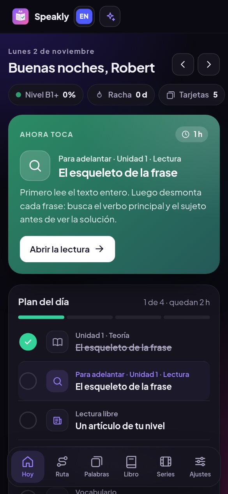</td>
    <td>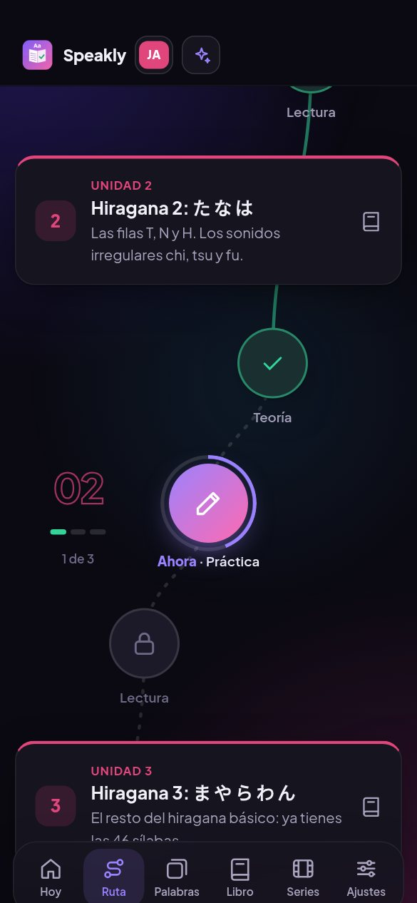</td>
    <td>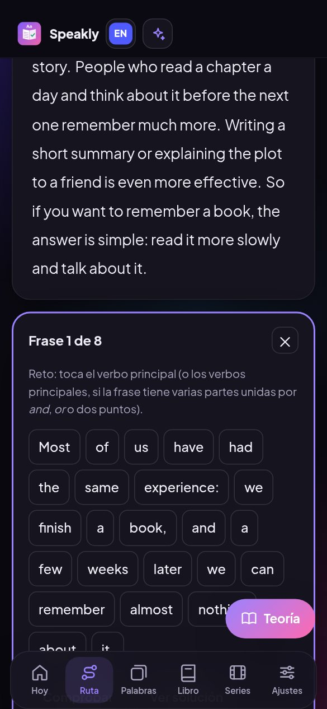</td>
    <td>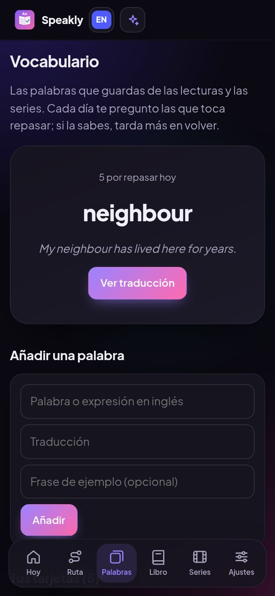</td>
  </tr>
</table>

## Instalar

Todo está en la [web de descargas](https://robertmartib.github.io/Talkiro) y en la [última versión](https://github.com/RobertMartiB/Talkiro/releases/latest).

| Plataforma | Archivo | Cómo |
|---|---|---|
| **Android** 6 o superior | `Talkiro-X.Y.Z-android.apk` | Descárgalo en el móvil, ábrelo y permite instalar apps de esa fuente. |
| **Linux** (Ubuntu, Debian, Mint) | `Talkiro-X.Y.Z-linux-amd64.deb` | Doble clic, o `sudo apt install ./Talkiro-X.Y.Z-linux-amd64.deb`. |
| **Linux** (otras distros) | `Talkiro-X.Y.Z-linux-x86_64.AppImage` | Dale permiso de ejecución y ábrelo. |
| **Windows** 10 y 11 | `Talkiro-X.Y.Z-win-x64.zip` | Descomprime y abre `Talkiro.exe`. |
| **Navegador / iPhone** | — | Abre la [versión web](https://robertmartib.github.io/Talkiro/app/) y añádela a la pantalla de inicio. |

**Si ya usabas Speakly o C1 Tracker** (los nombres anteriores): en el ordenador, Talkiro usa la misma carpeta de datos y conserva tu progreso. En Android, exporta antes tu progreso desde **Ajustes** por si tienes que desinstalar la versión anterior.

## Preguntas frecuentes

<details>
<summary><b>¿Cómo paso mi progreso del ordenador al móvil?</b></summary>

Si tienes un servidor Jellyfin, entra con el mismo usuario en la pestaña **Series** de los dos dispositivos y el progreso (días hechos, unidades, tarjetas y notas) se sincroniza solo. Si no, en **Ajustes** exporta tu progreso en uno e impórtalo en el otro.
</details>

<details>
<summary><b>¿Necesito Jellyfin?</b></summary>

No. Todo funciona sin él. Solo hace falta para ver series dentro de la app y para sincronizar entre dispositivos.
</details>

<details>
<summary><b>¿El chat con Claude es gratis?</b></summary>

Usa tu propia clave de API de Anthropic (se crea en [console.anthropic.com](https://console.anthropic.com)). Cada pregunta cuesta muy poco, pero no es gratis. El resto de la app no necesita ninguna clave.
</details>

<details>
<summary><b>Windows dice "Windows protegió tu PC"</b></summary>

Sale porque la app no está firmada. Pulsa **Más información → Ejecutar de todas formas**.
</details>

## Para desarrolladores

Una sola base de código en `src/` (HTML, CSS y JavaScript sin bundler) para las tres plataformas: escritorio con Electron, Android con Capacitor y web con GitHub Pages.

### Estructura

```
src/                  la app (compartida por todas las plataformas)
├─ courses/           cursos: registry.js (lista, curso activo y forma de estudiar) y el plan de cada uno (en.js, fr.js, ja.js…)
├─ units*/            contenido de las unidades de cada idioma: teoría, ejercicios y lectura
├─ course.js          convierte el temario en un calendario (modo plan)
├─ app.js             pantallas: Hoy, Ruta, recorrido por niveles, calendario, series y ajustes
├─ unit.js            teoría, práctica, lectura desmontada y libro
├─ vocab.js           tarjetas con repetición espaciada
├─ chat.js            mini chat con Claude (SDK empaquetado en vendor/anthropic.js)
├─ jellyfin.js        series y películas desde Jellyfin, con retos
└─ sync.js            sincronización del progreso entre dispositivos
main.js               ventana de escritorio (Electron)
android/              proyecto Android (Capacitor)
website/              web de descargas (GitHub Pages; la app web se copia en website/app/ al publicar)
docs/capturas/        capturas de este README
```

### Comandos

```bash
npm install
npm start             # app de escritorio
npm run dist:linux    # .deb y AppImage en dist/
npm run dist:win      # .zip para Windows en dist/
npm run vendor        # vuelve a empaquetar hls.js y el SDK de Anthropic en src/vendor/
npx cap sync android  # copia la app al proyecto Android
```

Para probar la versión web basta con servir `src/`, por ejemplo con `python3 -m http.server -d src`.

### Añadir una unidad

1. Crea el fichero en la carpeta del idioma (`src/units/uXX.js` para inglés, `src/units-fr/fXX.js` para francés…) con el mismo formato que las demás: `theory`, `exercises` y `reading`, con las frases desmontadas por papeles (`S V O R C X W`).
2. Añade el fichero a `files` del curso en `src/courses/registry.js`.
3. Si es de inglés, regenera el PDF del libro.

### Publicar una versión

1. Sube `version` en `package.json`.
2. `npm run dist:linux && npm run dist:win`.
3. Haz commit y push a `main`. La web se publica sola con GitHub Actions.
4. `gh release create vX.Y.Z dist/*.deb dist/*.AppImage dist/*.zip`. El APK de Android se compila en GitHub Actions y se añade solo a la release.

### Firma del APK

Si existen los secretos `ANDROID_KEYSTORE_BASE64` y `ANDROID_KEYSTORE_PASSWORD`, el APK se firma con esa clave y las actualizaciones se instalan encima. Si no, se firma con una clave de pruebas.

---

<p align="center">Hecha por Robert Martí · 2026</p>
